  

<h2>The city I built this year</h2>

  

Every building is a day; taller means more contributions.

  

<h2>Landmarks</h2>

  

  
    <a href="https://github.com/JackGrieco/RAG-app">RAG-app</a> ·
    <a href="https://github.com/JackGrieco/ArtigianatoOnline">ArtigianatoOnline</a> ·
    <a href="https://github.com/JackGrieco/FinanceManager-releases">FinanceManager</a> ·
    <a href="https://github.com/JackGrieco/PizzaManager-releases">PizzaManager</a>
  

<h2>Visit</h2>

  

